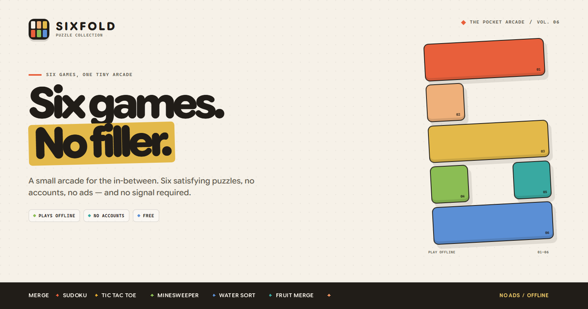

# Sixfold



Sixfold is a small, installable pocket arcade: six satisfying puzzle games in one offline web app. No accounts, no ads, no tracking — and it keeps working without a connection. The interface is available in English and Spanish.

**[Play Sixfold →](https://moh23rd.github.io/Sixfold/)**

**Merge** · **Sudoku** · **Tic Tac Toe** · **Minesweeper** · **Water Sort** · **Fruit Merge**

## The games

- **Merge** — classic 2048. Slide the tiles, match equal numbers, reach 2048 and keep going. Also plays on a 3 × 3 or 5 × 5 board.
- **Sudoku** — a standard 9 × 9 grid in Easy, Medium, Hard and Expert. Every puzzle has exactly one solution, with notes, undo, erase, hints, a timer and best times saved on the device.
- **Tic Tac Toe** — X goes first. Play another person or take on one of three computer levels, including a Perfect opponent that cannot be beaten, only drawn.
- **Minesweeper** — Beginner 9 × 9, Intermediate 16 × 16 and Expert 30 × 16, with a safe first tap, flags and chording.
- **Water Sort** — pour colour until every tube holds one colour. Eight fixed levels, easy to hard.
- **Fruit Merge** — a Suika-style drop-and-merge board with the canonical eleven-fruit chain and triangular pair scoring.

Every game saves its own board, best score and progress on the device, so closing the tab never loses a round.

## Daily Sixfold and Learn mode

- **Daily Sixfold** gives every game a date-seeded challenge: a seeded Merge board, Sudoku grid, Tic Tac Toe computer, Minesweeper field, Water Sort level and Fruit Merge run, plus a local streak and a 30-day calendar. It works offline and never needs an account or a server.
- **Daily boards are separate from normal saves.** A daily run never replaces the board or level you were already playing.
- **Daily Sudoku** is the same grid for everyone on that local date. Past days can be replayed from the calendar.
- **Sudoku Learn mode** explains naked and hidden singles, fills auto-notes, can mark mistakes, and includes a short guide to pairs, pointing pairs and box-line reduction.
- **Daily share** produces a spoiler-free link, so a friend can open the same daily puzzle without seeing the answer.
- **Backup and restore** exports every board, score, streak and setting as a JSON file. `navigator.storage.persist()` asks the browser to keep the data.

## English and Spanish

The interface can switch between **English** and **Español** in
**Look & feel → Language**. The first visit follows the device language; the
choice is saved on the device, game dates use the selected locale, and daily
share text follows it too. The catalog is source-string based, so a new
language can be added without rewriting the markup.

## Native apps

The same web release is wrapped with Capacitor 8 for Android and iOS. The
native projects live in `android/` and `ios/`; `native/` holds the build notes,
store listing copy, review notes and privacy policy. Native builds stage the
static shell through `npm run native:sync`, disable the service worker and use
the official splash, status-bar and back-button plugins.

The native binaries have not been signed or uploaded: those steps need a macOS
machine, Xcode and the store accounts. See [native/README.md](native/README.md).

## A small, considered arcade

- **Made for a phone, comfortable on a desk.** The hub and every game layout adapt from a 320px screen up to a wide desktop.
- **One look for the collection.** Light, dark or auto, with six colour palettes. The page and the browser chrome always match.
- **Quiet motion.** Springy entrances, tactile result cards and a stamped seal when a round is cleared, with a still fallback for reduced motion.
- **Play how you like.** Touch, mouse and full keyboard controls, plus screen-reader labels throughout. High contrast, colour-blind cues, larger Sudoku digits, left-handed landscape and optional sounds are in Look & feel.
- **Installable.** Add Sixfold to a home screen for an app-like window and offline play.
- **English and Spanish.** The complete interface, aria labels and dates follow the selected language.
- **Native shells included.** Capacitor projects for Android and iOS live alongside the web app.
- **Updatable without a hard refresh.** A ready service-worker update appears as a small Reload prompt.

## Tests

```sh
npm install
npx playwright install chromium
npm test
```

The Playwright suite covers the six game screens, Daily Sixfold, Sudoku Learn hints, settings and backup download. Axe scans the hub, all six games and settings in both light and dark themes, with no rule exceptions. CI runs the same suite on every push and pull request, and can be run manually from the Actions tab.

## Install

- **Android / Chrome:** open **About & privacy** from the hub and tap **Install app** when it appears.
- **iPhone / Safari:** tap **Share**, then **Add to Home Screen**.
- **Other browsers:** use the browser menu’s **Install** or **Add to Home Screen** option.

The app works offline after the first visit. If Chrome says it is installed but will not open, remove any old copy from the Home Screen or browser app settings and try again. On Chrome for Android 154–156, Chrome’s own install menu can confuse two apps on the same `github.io` origin; update Chrome to **157.0.8103.15** or newer. The hub shows this recovery note automatically on older builds and offers the page’s install prompt as a workaround.

## Privacy

No accounts, ads, analytics or third-party scripts. Boards, scores and appearance choices stay in local storage on the device. The light/dark choice is also kept in a first-party cookie so an installed app can pick matching launch chrome. The phone controls the bottom system bar, so that bar keeps the colour it was given at install time.

**Erase all data** in Look & feel removes every board, score, streak, saved puzzle and appearance choice. Each game also has its own reset in its bottom tool row.

## Running locally

Serve the repository root over localhost, because the service worker and install prompt need a real origin:

```sh
python3 -m http.server 8000
```

Open `http://localhost:8000`. Opening `index.html` directly still plays, but offline caching and installation stay off.

## Beta previews

Beta builds are previews, never releases. They do not change the app version, the offline cache name, tags or the published release, and nothing in `beta-build/` is committed or deployed.

```sh
./beta.sh            # build and serve at http://localhost:4173
./beta.sh --build    # build only, into beta-build/
./beta.sh --port 5000
```

The script copies the current working tree — uncommitted changes included — into a gitignored `beta-build/` folder and marks that copy so it cannot be mistaken for the live app:

- a small **beta** tag beside the version on the hub, carrying the commit and build time in its tooltip;
- `<meta name="robots" content="noindex, nofollow">` and a ` · beta` title suffix;
- service-worker registration removed, so a preview never caches itself and can never overwrite the published offline shell.

The preview is served on its own port from `beta-build/`, so the published site keeps serving its current release untouched. Do not serve a beta from a path on the live origin: the published service worker's scope covers the whole site and would cache the preview as the app shell. Shipping a change stays a separate, explicit step; a beta never gets a tag, a GitHub release or a version bump.

## Project structure

```
index.html                 hub, game screens, help, install and rules sheets
styles.css                 shared shell, theme tokens and the 2048 board
home.css                   hub layout, six-piece intro and cartridge cards
games.css                  in-game screens and controls
polish.css                 motion, result cards and Wordle styles
v5.css                     Daily Sixfold, settings, learning and update surfaces
daily.js                   daily set, streak, calendar and share link
settings.js                accessibility, input order, persistence and backup
sound.js                   optional interface sounds
update.js                  service-worker update prompt
game.js                    Merge (2048)
games.js                   Water Sort, Sudoku adapter, Fruit Merge, Tic Tac Toe, Minesweeper
sudoku.js                  Sudoku generator, solver, controls and saved progress
sudoku.css                 Sudoku board, pad, result and difficulty styles
i18n.js                    English/Spanish catalog, locale-aware rendering and the language switch
native.js                  native splash, system bars and Android back navigation
capacitor.config.json      Capacitor app id, web bundle and splash settings
native/                    wrapper build notes, store listings, review notes and privacy policy
android/, ios/             generated Capacitor native projects
scripts/build-native.mjs   stages the static shell and native-only plugin bundle
wordle.js                  the hidden five-letter game and its saved stats
wordle-words.js            offline answer and accepted-guess lists
theme.js                   palettes, light/dark, focus and appearance controls
overscroll.js              Android stretch overscroll on the hub
celebrate.js               result flourish and stamped seals
sharecard.js               share-card drawing for every game
sw.js                      offline cache (bump VERSION when assets change)
manifest*.webmanifest      install metadata for light and dark chrome
icons/, splash/, fonts/    app icons, iOS launch images and the typeface
```

The site is published with GitHub Pages from the `main` branch root. No build step is required.

## Release notes

Version history lives in [CHANGELOG.md](CHANGELOG.md); tagged builds are on [GitHub Releases](https://github.com/Moh23rd/Sixfold/releases).

## Rules references

The games were checked against their original rules: Gabriele Cirulli’s 2048, Nintendo’s Suika Game (fruit chain and pair scoring), the standard Minesweeper field sizes and first-click convention, classic water-sort rules, standard Sudoku with unique solutions, and standard tic-tac-toe with a minimax opponent.

## Credits and licence

Game code is released under the [MIT License](LICENSE). The Google Sans Flex typeface is included under the [SIL Open Font License 1.1](fonts/OFL.txt).

Questions or bug reports: [mohrd9685@gmail.com](mailto:mohrd9685@gmail.com).
